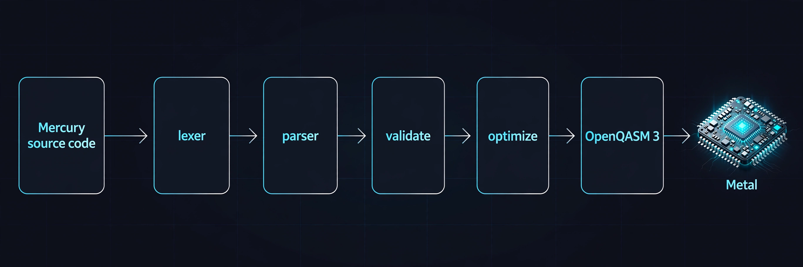
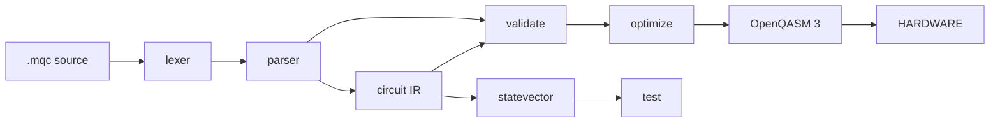
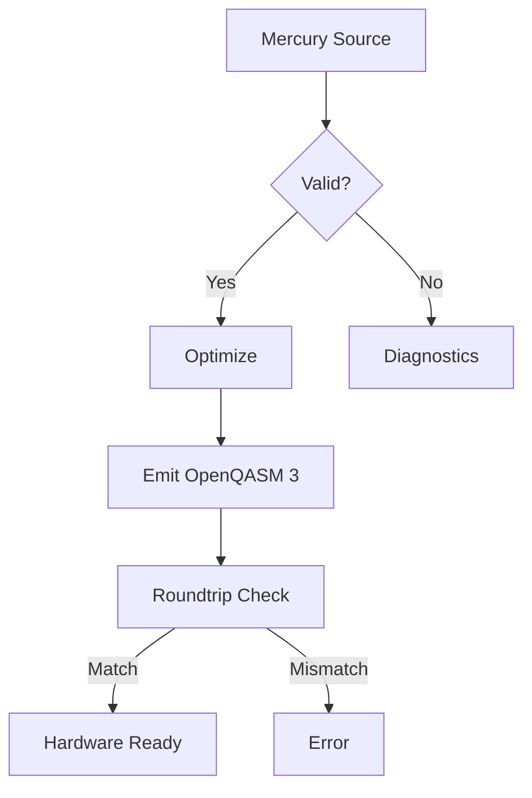
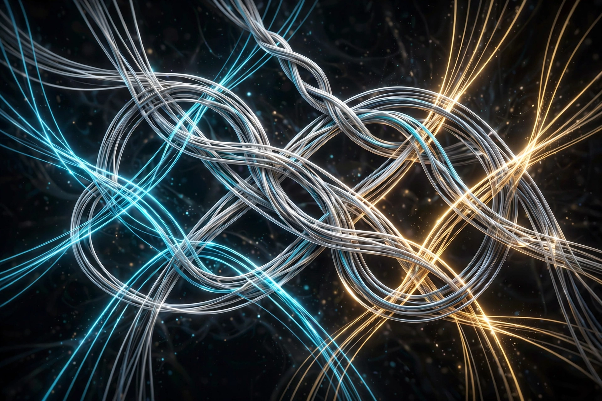
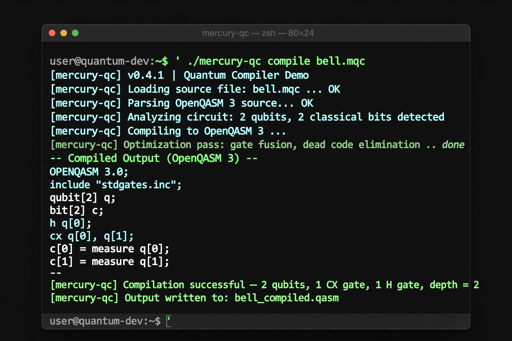
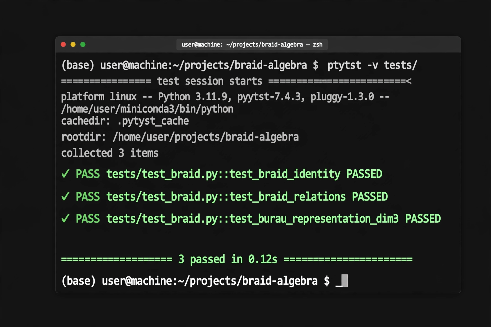
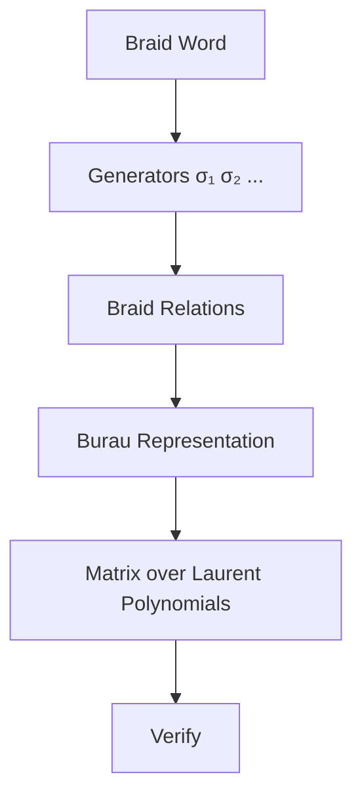

<!-- SPDX-License-Identifier: LicenseRef-Sovereign-Leviathan-SL-AGPL3-001 -->
<!-- Copyright (c) 2026 Ahmad Ali Parr. All rights reserved. -->
<!-- Authored by Ahmad Ali Parr. -->
<!-- Licensed under the SNAPKITTY OPAQUE SOURCE LICENSE v1.0. See LICENSE. -->

# mercury-to-metal


[](LICENSE)
[](https://mercurylang.org)
[](specifications/interchange/QASM_SUBSET.md)
[](compiler/src/)
[](tests/)

### Mercury in. OpenQASM out. Metal next.

Most quantum compilers are written in Python. They sit on top of layers of abstraction, frameworks, and dependencies. They work — until they don't. Until the version pins break. Until the framework changes. Until you're debugging someone else's stack instead of your circuits.

**This one is written in Mercury.**

Mercury is a logic programming language. Pure. Deterministic. Strongly typed. No side effects unless you declare them. When Mercury says a predicate is `det`, it means it — one solution, no backtracking, no surprises. When it says `is det`, the compiler proves it.

That's what you want when you're generating instructions for hardware that doesn't forgive mistakes.

---

## Why Mercury?

Because quantum circuits are logic. A gate either applies or it doesn't. A qubit is either entangled or it isn't. There's no "maybe" in a unitary matrix.

Python lets you write anything. Mercury makes you prove it works.

- **Determinism by construction.** Every predicate declares its determinism. The compiler checks it. No runtime surprises.
- **No hidden state.** Mercury's modes (`di`, `uo`) make data flow explicit. You can trace every value from input to output.
- **Pattern matching that means it.** Mercury's switch detection proves your cases are exhaustive. Miss a gate type, the compiler tells you.
- **Types that catch real bugs.** Not "stringly typed." Real algebraic data types. A `circuit` is a `circuit`, not a dict with string keys.

When you're emitting instructions for a quantum device or an FPGA, you don't want "it probably works." You want "the compiler proved it."

---

## The Pipeline







```
.mqc source
  → lexer      tokens with line:column
  → parser     circuit IR (broadcasts expanded)
  → validate   bounds, arity, declarations, operands, bits
  → optimize   gate cancellation, fusion, broadcast (-O1)
  → qasm_emit  OpenQASM 3 (frozen subset)
  → HARDWARE
```

The OpenQASM 3 output is the handoff. Frozen subset — deterministic, validated, optimized. Feed it to a quantum device, an FPGA controller, a simulator, whatever runs the metal.

**The statevector evaluator is for testing.** It simulates circuits classically so you can verify the compiler's output. It is not the destination. The destination is hardware.

---

## Braid Words



Quantum gates braid. Literally. The topology of a quantum circuit — which qubits interact, in what order — forms a braid. Braid group theory gives you tools to reason about circuits that gate-level thinking doesn't.

This repo includes a braid-word algebra in Mercury:

- **Braid words** — sequences of generators (σ₁, σ₂, ...) with inverses
- **Burau representation** — matrices over Laurent polynomials
- **Braid relations** — σᵢσⱼ = σⱼσᵢ for |i-j| > 1, σᵢσᵢ₊₁σᵢ = σᵢ₊₁σᵢσᵢ₊₁

Why? Because topological quantum computing uses braids as gates. Because braid invariants can detect when two circuits are equivalent. Because the math is beautiful and it works.

The braid module is independent — it doesn't depend on the compiler. It stands on its own as pure algebra.

---

## What This Is Not

- **Not a simulator.** The statevector evaluator simulates for testing. The compiler's job is to emit OpenQASM for real hardware.
- **Not a framework.** No dependencies beyond Mercury's standard library. No Python. No JavaScript. No Qiskit. Just Mercury.
- **Not a toy.** 2,992 lines of Mercury. 9 compiler modules. 368 lines of braid tests. Corpus of valid, invalid, and warning cases with golden outputs.
- **Not finished.** Klong numerics in progress. Unitary and Fibonacci braid representations next. C runtime planned. Hardware integration is the goal — the OpenQASM handoff is ready.

---

## Quick Start

```bash
# Build the compiler (requires Mercury 22.01.9)
make compiler

# Check a circuit
./compiler/bin/mercury-qc check tests/compiler/corpus/valid/bell.mqc

# Compile to OpenQASM 3
./compiler/bin/mercury-qc compile tests/compiler/corpus/valid/bell.mqc

# Simulate (classical, for testing)
./compiler/bin/mercury-qc statevector tests/compiler/corpus/valid/bell.mqc

# Verify roundtrip (emit → parse → emit → identical)
./compiler/bin/mercury-qc roundtrip tests/compiler/corpus/valid/bell.mqc

# Run all tests
make test
```

---

## Demo

### Compile a Bell state



Input (`.mqc`):

```
version 0;
qubit[2] q;
bit[2] c;
h q[0];
cx q[0], q[1];
measure q -> c;
```

Output (OpenQASM 3):

```qasm
OPENQASM 3.0;
include "stdgates.inc";
qubit[2] q;
bit[2] c;
h q[0];
cx q[0], q[1];
measure q -> c;
```

Feed that to hardware. Done.

### Braid algebra tests





Braid words, Burau representation, braid relations — all verified in Mercury.

---

## Example

---

## The Principle

```
MERCURY → OPENQASM → METAL
```

Write circuits in a language that proves correctness. Emit in a format hardware understands. Run on metal.

No abstraction layers. No framework rot. No "it works on my machine."

**Mercury in. OpenQASM out. Metal next.**

---

## License

SPDX-License-Identifier: LicenseRef-Sovereign-Leviathan-SL-AGPL3-001 (SNAPKITTY OPAQUE SOURCE LICENSE v1.0). See [LICENSE](LICENSE).
